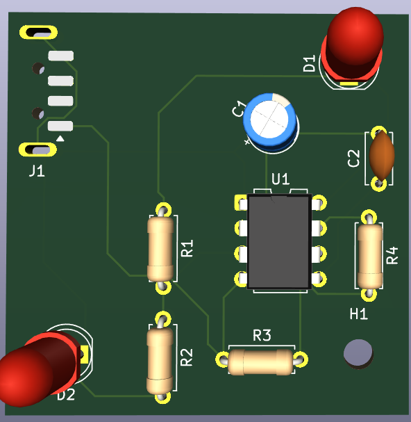
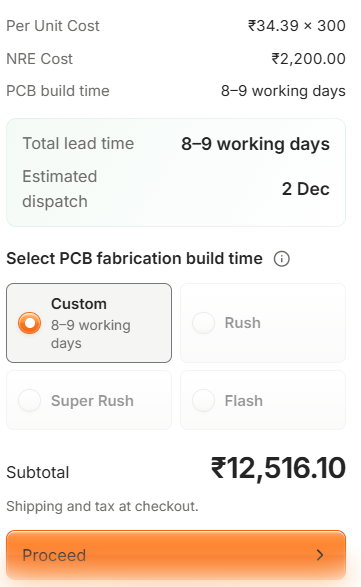

# Badge Name: Red-blue

> Space Carnival 2026 — PCB Badge Design Competition entry.
> Competition guide: https://space-carnival-psi.vercel.app/badge/

**Designer(s):** Angelina Mary George, Kochi, and a github.com/AngelinaMaryGeorge

## The idea

A compact 40 × 40 mm USB-A powered badge that alternates a Blue and Red LED using a classic NE555P timer, while doubling as a pocket millimeter ruler along its edge for everyday desk use.

## Theme

It celebrates Kochi and Kerala's resourceful, hands-on maker culture by turning a classic analog circuit into a practical keepsake tool built for tinkering at TinkerSpace.

## How it works

- **Power:** 5 V USB (horizontal male USB-A plug)
- **Main parts:** 1 × NE555P timer IC (DIP-8), 2 × 5 mm LEDs (Blue & Red), 4 × through-hole resistors (2 × 330 Ω, 1 × 1 kΩ, 1 × 150 kΩ), 2 × capacitors (10 µF, 10 nF), 1 × USB-A male plug
- **What happens when you power it:** Plugging it into any USB-A port, laptop, or power bank runs the NE555P in astable mode, causing the Blue and Red LEDs to blink alternately.

## Soldering experience

To solder: 9 easy through-hole components and 1 wide-pitch USB-A plug in about 15–20 minutes.

## Checklist

- [x] Board fits within 40 × 40 mm
- [x] Total BOM under ₹50 per badge, including the PCB and battery (see `bom.csv`)
- [x] Every BOM row has quantity, unit price at 300 units and a source link
- [x] Manufacturable by Lion Circuits (checked against their capabilities)
- [x] Schematic in `schematic/` (PDF + source files)
- [x] Gerbers zipped in `gerber/`
- [x] Render or photo(s) in `images/`

**BOM total per badge:** ₹34.39 (300 badge order)

## Files

| Folder / file | What goes in it |
| --- | --- |
| `schematic/` | KiCad schematic PDF (`Carnival.pdf`) and source files (`Carnival.kicad_sch`, `Carnival.kicad_pcb`) |
| `gerber/` | Zipped Gerber and Excellon drill files ready for Lion Circuits |
| `bom.csv` | Component list with quantities, 300-unit prices (₹), and source links |
| `images/` | 3D front and back renders of the badge (plus Lion Circuits quote screenshot) |

## License

MIT License (see `LICENSE` file).
